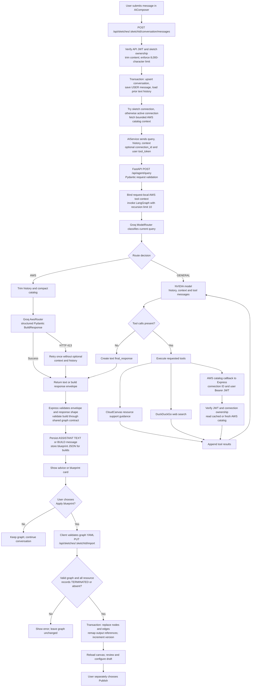
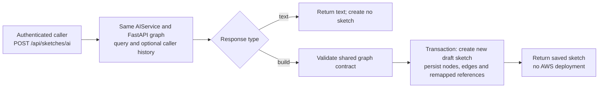

# AI request flow

[Documentation map](README.md) · [User flow](user-flow.md)

The active agent graph uses Groq for route selection and structured AWS builds,
and NVIDIA NIM for general conversation with tools. Although a `Llama` wrapper
exists, the compiled graph does not use it. Responses are returned as a single
JSON result; the current UI does not stream tokens.

## Persisted sketch conversation

The budget step describes request preparation and the optional retry around the
build call. The tool loop is bounded by LangGraph's recursion limit. NVIDIA has a
configured 110-second request timeout; the Express adapter has a 120-second
request timeout, which is not a durable job deadline or cancellation mechanism.

The controller sends prior conversation text plus catalog context; it does not
automatically serialize the current canvas into AI context. If catalog context
cannot be fetched, it falls back to empty context. Tools require a connection and
the forwarded API JWT; without them the catalog tool returns an error. The JWT is
held in request-local tool context, not included in the model's prompt inputs.

The backend saves the user message before calling AI. On failure it returns an
error and the saved message identifiers, and the UI reloads the conversation.
There is no automatic assistant-message retry or idempotency key. Adapter error
mapping is 400 for an invalid local request, 504 for timeout, 503 for unavailability,
and 502 for other upstream/response errors. Pydantic validation at FastAPI can
reject input before graph execution.

FastAPI currently accepts the query route without a service key; only its catalog
callback re-enters the authenticated Express boundary. The Python schema and
TypeScript graph contract are separate definitions. Successful model structure
validation is followed by Express graph validation, so generated output can still
be rejected. A valid draft may also need user choices such as an AMI or Lambda ZIP
before it can be deployed.

## Other supported API operations

The direct creation endpoint does not use the persisted conversation controller
or add its catalog/tool context. It is available in the server API but has no
current dashboard entry point. Conversation GET loads messages, and conversation
DELETE clears that conversation and its messages without deleting the sketch or
resources.

## Source entry points

- [AI composer](../client/src/components/graph/AiComposer.tsx), [blueprint application](../client/src/components/graph/GraphEditor.tsx)
- [Conversation controller](../server/src/controllers/conversationController.ts), [AI adapter](../server/src/services/aiService.ts), [direct creation and import](../server/src/controllers/infrastructureController.ts)
- [FastAPI query route](../service/routers/agent.py), [compiled graph](../service/agents/graph.py), [graph nodes](../service/agents/nodes.py), [Pydantic schemas](../service/schemas/agent.py)
- [Groq routing and budget handling](../service/services/router.py), [NVIDIA wrapper](../service/models/nvidia.py), [model settings](../service/config/models.py)
- [AWS catalog tool](../service/tools/aws_catalog.py), [support tool](../service/tools/cloudcanvas.py), [search tool](../service/tools/search.py)
