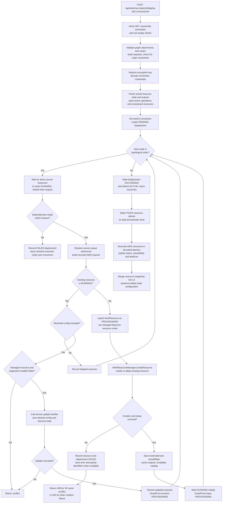
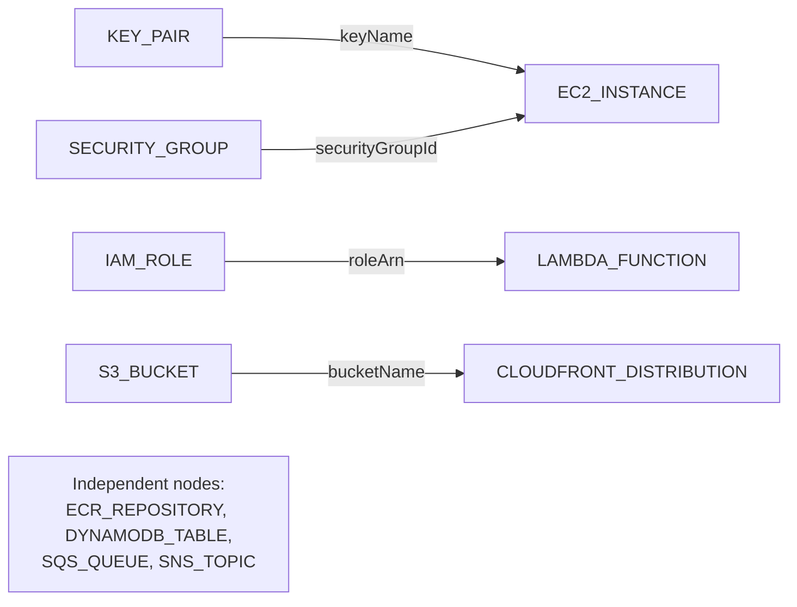
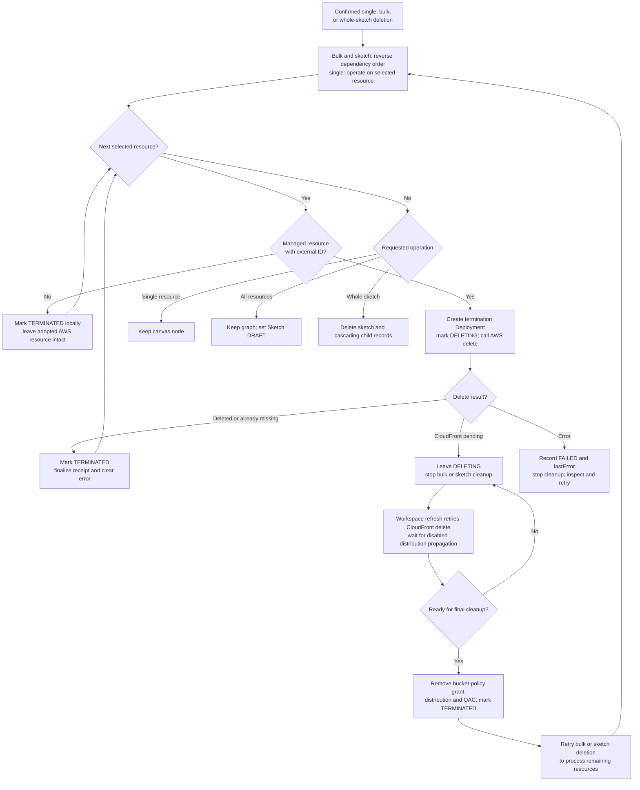

# Deployment lifecycle

[Documentation map](README.md) · [User flow](user-flow.md)

Publish runs sequentially within the Express request. There is no external job
queue or transaction spanning AWS calls and PostgreSQL. Earlier successful
resources remain after a later failure; cleanup is explicit.

## Publish and readiness

Early guard/plan/decryption failures return before the deployment loop. The
diagram groups those checks for readability. The default dependency wait is
90 seconds with a 3-second interval. Resource refresh defaults to batches of four;
the editor interval defaults to 30 seconds, with a 10-second minimum.

`SUCCEEDED` records completion of the publish loop. Creation normally marks a
resource `RUNNING` before a later describe refresh; CloudFront is explicitly kept
`PROVISIONING`. Dependency waits verify readiness before a dependent node starts.
These statuses are application observations, not a guarantee of application health.

The existing-resource update branch is implemented in `deploySketch`, but normal
canvas config updates are blocked for live resources by `updateSketchNode`.
Some conflict/update exits after creating a deployment return without marking its
record failed, leaving it `PENDING`. Preflight state checks are not an atomic lock:
concurrent requests can pass them. The diagram does not imply automatic rollback,
durable recovery, or exactly-once execution.

## Supported dependency and output flow

An edge points from a dependency to its consumer. References use exact values
such as `${bucket-node.bucketName}` and require a direct incoming dependency edge.
They are not arbitrary string interpolation. Import remaps source IDs to database
IDs; deployment resolves references against stored or freshly retrieved outputs.
The four independent types can coexist on a canvas but have no supported
attachments. An SNS-to-SQS line, for example, would not create a subscription.
EC2 instance profiles are selected from the catalog; the graph does not implement
an IAM-role-to-EC2 attachment.

## Cleanup and pending CloudFront deletion

Already terminated records are skipped. Bulk cleanup stops on the first pending
or failed result. If graph planning fails, its implementation falls back to reverse
node order; it is not an AWS dependency discovery engine. Single-resource deletion
does not walk dependents, so AWS can reject an in-use resource.

The refresh path advances CloudFront deletion only while called; there is no
background cleanup daemon. A termination deployment can be marked `SUCCEEDED`
when asynchronous deletion is merely accepted, while the resource is `DELETING`.
Failed CloudFront setup and recorded incomplete setup are excluded from ordinary
refresh so errors remain available for explicit cleanup. S3 deletion clears object
versions and delete markers; ECR deletion is forced. These actions can remove data.

## Source entry points

- [Deployment and cleanup controller](../server/src/controllers/infrastructureController.ts), [resource dispatcher](../server/src/services/aws/index.ts)
- [Deployment graph and reference resolution](../server/src/services/aws/graph.ts), [readiness helper](../server/src/services/aws/readiness.ts), [timing/concurrency settings](../server/src/lib/config.ts)
- [Contract graph rules](../contracts/src/index.ts), [resource schema](../contracts/graph.schema.json)
- [CloudFront lifecycle](../server/src/services/aws/resources/cloudfront.ts), [S3 cleanup](../server/src/services/aws/resources/s3.ts), [ECR cleanup](../server/src/services/aws/resources/ecr.ts)
- [Editor polling](../client/src/components/graph/GraphEditor.tsx), [poll interval](../client/src/lib/config.ts)
