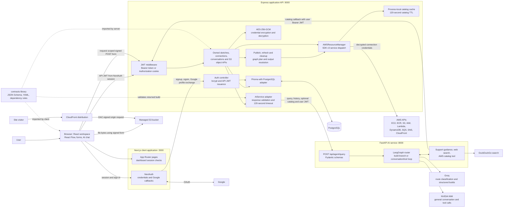
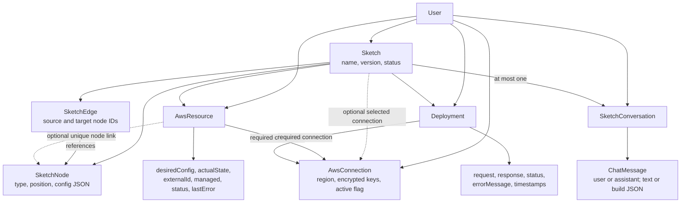

# System architecture

[Documentation map](README.md) · [User flow](user-flow.md)

CloudCanvas separates the design UI, application API, and AI runtime. Express
owns persistence and AWS operations. AI produces advice or draft graphs; resource
creation is performed only through the deployment API.

## Runtime components

Ports are local defaults, not a prescribed production topology. The browser calls
Express directly for workspace APIs; these calls are not Next.js API proxies.
Responses return along the request path. S3 uploads are the exception: Express
signs an upload, and the browser sends the file directly to S3. The CloudFront/S3
path depicts infrastructure users may create, separate from CloudCanvas hosting.

## Persistence relationships

Arrows below mean “has records,” not request flow. Optional links are labeled.

Desired node configuration and recorded AWS state are separate. Deleting a node
sets its resource link to null; controllers first block deletion of live or
unresolved resources. Connection deletion is restricted by resource/deployment
foreign keys. Sketch/conversation child records use cascading deletion; the
sketch controller attempts AWS cleanup before deleting database records.

## Boundaries and limits

AWS credentials enter through connection settings and are encrypted at rest with
`AWS_ENCRYPTION_KEY`; the API returns connection metadata. The AI receives catalog
metadata and, for tools, the user's API JWT rather than raw AWS credentials.
Catalog caching is process-local, not shared across replicas.

Protected controllers scope data to the JWT user ID. This is not proof that every
boundary is hardened: FastAPI has no service authentication in the current source,
and the Express Google exchange does not verify a Google token independently.
There is no durable deployment worker or event-driven AWS status feed.

## Source entry points

- [Client auth callbacks](../client/src/app/api/auth/[...nextauth]/options.ts), [API client](../client/src/lib/api.ts), [graph editor](../client/src/components/graph/GraphEditor.tsx)
- [Express entry point](../server/src/index.ts), [JWT middleware](../server/src/middlewares/authenticate.ts), [infrastructure controller](../server/src/controllers/infrastructureController.ts)
- [AWS dispatcher](../server/src/services/aws/index.ts), [encryption](../server/src/services/aws/crypto.ts), [bucket APIs](../server/src/controllers/bucketObjectsController.ts)
- [Prisma schema](../server/prisma/schema.prisma), [shared graph contract](../contracts/src/index.ts)
- [FastAPI route](../service/routers/agent.py), [active agent graph](../service/agents/graph.py), [catalog callback](../service/tools/aws_catalog.py)
