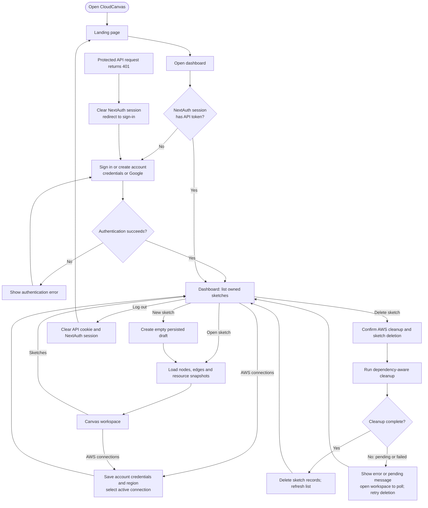
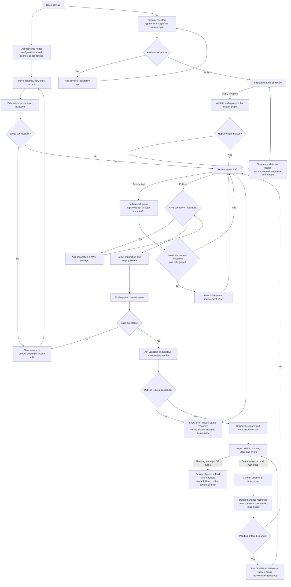

# User flow

[Documentation map](README.md) · [System architecture](system-architecture.md)

This flow follows the current browser UI. Import and direct AI sketch creation
also exist as API operations; the dashboard currently exposes New sketch and
Open sketch, without a standalone import or AI-create screen.

## Entry and workspace

An AWS connection is required for publishing and catalog-backed configuration,
but users can create a sketch before adding one. Saving a connection stores its
credentials; it does not prove AWS permissions. Catalog or deployment calls may
subsequently fail. Deleting a connection used by resource or deployment records
returns a conflict.

## Design, review, and publish

Autosave preserves canvas edits through incremental node/edge APIs. Save and
Apply blueprint both replace the full graph, regenerate persisted node IDs, and
remap references. Apply blueprint overwrites the graph rather than merging it.
Neither action provisions AWS resources. Publish first waits for queued saves;
its completion does not guarantee every resource has reached AWS readiness.

Configuration changes to a live resource are blocked by the current node PATCH
handler, even where forms describe publish-time updates. Delete or detach the
resource before changing its configuration. Position and label edits remain
separate from AWS configuration changes.

Single-resource cleanup retains the canvas node. Delete all resources retains
the graph too; whole-sketch deletion removes the graph and conversation after
cleanup succeeds. CloudFront propagation can require keeping the editor open
and retrying the remaining bulk or sketch deletion later. S3 bucket cleanup
removes contents, including versions; ECR cleanup uses forced repository deletion.

## Source entry points

- [Dashboard guard](../client/src/app/dashboard/page.tsx), [sketch index](../client/src/components/dashboard/SketchIndex.tsx), [connection settings](../client/src/components/dashboard/AwsConnectionsPanel.tsx)
- [Editor and autosave](../client/src/components/graph/GraphEditor.tsx), [publish control](../client/src/components/graph/PublishSketchButton.tsx), [AI composer](../client/src/components/graph/AiComposer.tsx)
- [S3 object panel](../client/src/components/graph/BucketObjectsPanel.tsx), [invalid-session handler](../client/src/components/auth/InvalidSessionHandler.tsx)
- [Server lifecycle and edit guards](../server/src/controllers/infrastructureController.ts), [AI detail](ai-request-flow.md), [deployment detail](deployment-lifecycle.md)
